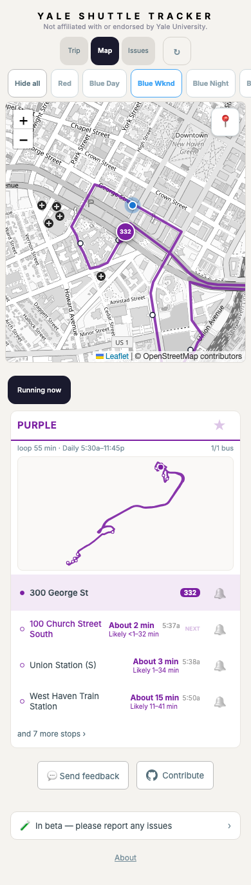
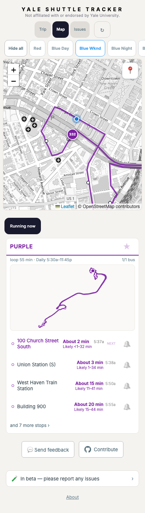

Purple #332 after departing 300 George St

The bus is about 156 m beyond the curb in the same recorded production observation (2026-10-25 05:34:48 ET). The before image shows the original served forecast; the after image uses the candidate engine independently replayed from the original empty common past. Both images render the release bundle at 390 × 844 with the same recorded GPS and clock.

Before: the completed curb is highlighted as the bus’s current stop. After: the card starts at 100 Church Street South, and its upcoming estimate and later stops remain visible.

These are historical replay screenshots. They do not prove boarding, future arrival accuracy, or live deployment. The earlier mode reversal while inside the 75 m curb zone remains unresolved.

