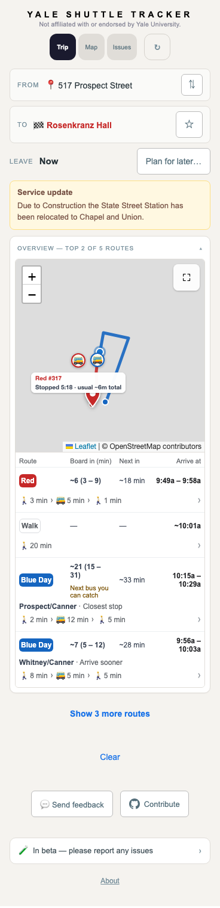

# Approaching shuttles alongside boarding choices

When a shuttle arrives before the estimated walk finishes, the route table
can show a later boarding choice without showing the approaching shuttle's
time. In the recorded corridor example, Blue #48 is under a minute away
while the planned boarding is about 21 minutes away on #44.

The overview and details now show the earlier forecast and estimated walk.
The itinerary, following arrival, reminder, and boarding actions retain their
existing selected bus. Repeated pickup visits retain their first arrival as
information even when the itinerary boards a later pass. A missing or stale
forecast removes the notice. Visible approaching buses on both pickup
choices receive the existing offline and return alerts.

| Before | After |
| --- | --- |
|  |  |

The screenshots use the existing October 12 feed and prior corridor proxy.
Report #104 did not retain exact GPS or an image. Availability transitions and
the second test origin are controlled UI inputs. Map tiles are blocked. These
checks establish presentation and lifecycle behavior, without measuring ETA
accuracy or independent physical boarding truth.

Validation: 3,898 tests, backend/frontend/display-audit types, Vite build,
desktop and phone checks at both origins, Blue pickup/reminder regression,
and the preceding Brown overview regression. The browser check verifies
that telemetry still reads the planned boarding estimate, tests the absence
of a later boarding forecast, and exercises loss/return alerts for the
primary and alternative pickup. It runs as the eighth deployment browser
regression with the existing two-minute deadline.

Run from `services/shuttle-v2`:

```sh
BOT_CHROMIUM_PATH=/path/to/chrome node scripts/early-pickup-check.mjs
```

The stage forces local built assets. For read-only verification against the
production bundle, set `EARLY_PICKUP_PRODUCTION_ASSETS=1`; all browser API
calls still use the recorded fixture. `EARLY_PICKUP_OUT` selects the capture
directory. Phase logs and failure captures identify incomplete checks.
