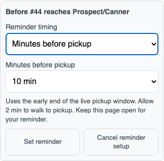
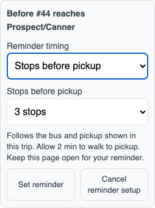

# Pickup reminder controls

The trip’s **Remind me** button opens settings before arming. Riders can choose 1, 3, 5, 10 or 15 minutes before pickup, 1–5 stops before pickup, or the existing automatic time-to-leave reminder. Armed reminders show their timing and offer Change reminder; cancelling setup preserves an existing arm.

Custom reminders fire once from the selected boarding visit’s live ETA window or stop count. They remain attached to the chosen pickup, including a later bus or return visit. The walking estimate and page-open requirement appear beside the settings. The original leave-time option retains its two pings.

The built-SPA check covers 307 px with compact Android layout, plus 320, 390 and 1280 px, keyboard focus, notification permission only on Set reminder, editing and cancelling, once-only delivery, and the earlier passing bus being ignored. Requests and notification delivery are intercepted; this establishes UI/timing behavior and makes no native push or ETA accuracy claim. Results: [browser-results.json](browser-results.json).

Run from `services/shuttle-v2` after building: `BOT_CHROMIUM_PATH=/path/to/chromium node scripts/pickup-reminder-check.mjs`. Set `BOT_BASE_URL=https://yale-shuttle.fly.dev` to exercise production assets with the same intercepted fixture APIs.
