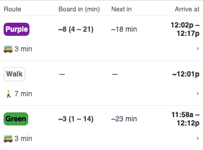
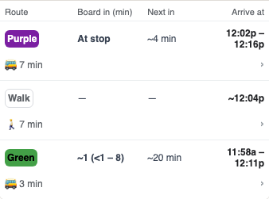
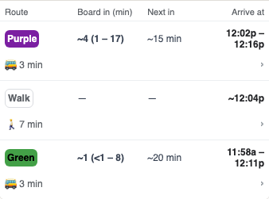

Recorded October 24 Building 600 → Building 900 trips, rendered with the real baseline and corrected bundles at the original poll times. The current boarding call is followed by Building 400 and a return to Building 600 before Building 900. The forecast visit stays two stops ahead.

Green changed from 0 → 2 → 0 stops ahead to 2 → 2 → 2; Purple changed from 2 → 0 → 2 to 2 → 2 → 2. The baseline also offered an incorrect boarding prompt; it was dismissed before the table screenshots. The corrected view did not offer that prompt. Boarding remains available for Building 400, which comes before the return pickup.

| Route | Before | After |
| --- | --- | --- |
| Green |  |  |
| Purple |  |  |

The original raw inputs and current-math wires are in the committed fixture. Browser results preserve all twelve observed frame samples. These are recorded UI regressions, not independent proof of vehicle doors or boarding. All external browser requests were blocked.
