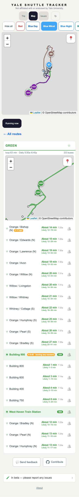
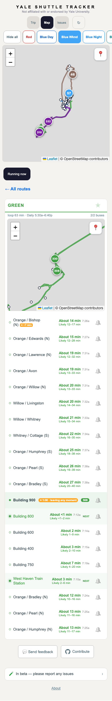
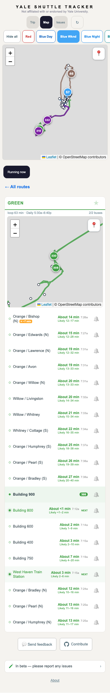

The same original Green payloads and clocks rendered at 390 × 844 in the shipped baseline and the corrected app. These screenshots check bus/clock attribution; they do not establish physical arrival or ETA accuracy.

| Recorded case | Before | After |
| --- | --- | --- |
| Bus 330 has its own 15-second rest; bus 308 has a different 45-second rest at the same stop. |  |  |
| Bus 308 has no model rest at this stop; bus 330 supplies the other clock. |  |  |

The browser gate also checks all four recorded payloads in both raw-bus orders at 307, 390 and 1280 pixels, including matching-clock positive controls. [Original frame hashes and render details](preview.json).
