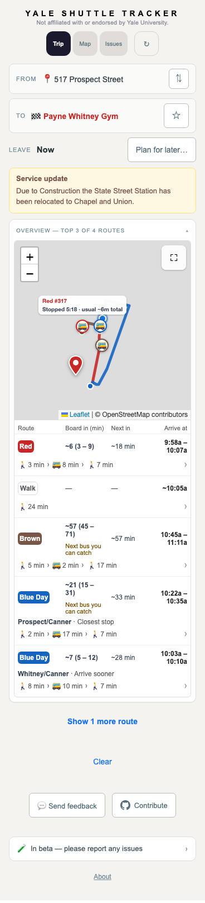
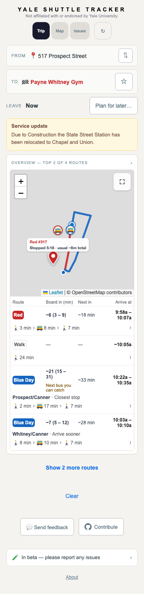

# Walking benefit in the route overview

Brown to Payne Whitney Gym could show about 22 minutes of walking beside a
24-minute direct walk. The overview credited a shorter walk from another
pickup/exit pair that the planner never offered as a selectable trip.

Visibility now uses the selected trip and its explicit pickup alternatives.
Brown remains under Show more in this case. The closest Blue pickup and its
earlier-arriving alternative remain visible and independently selectable.

The new regression runs the full planner on the existing October 12 feed,
with Payne Whitney Gym as the destination and the prior 517 Prospect corridor
origin as a proxy. The original report #126 did not retain exact GPS. These
captures demonstrate selection and display behavior, not historical ETA
accuracy. Map tiles are blocked in the browser harness.

| Before | After |
| --- | --- |
|  |  |

Validation: 3,886 tests, backend/frontend/display-audit type checks, frontend
build, desktop and phone browser checks, and the existing Blue pickup,
directions, and reminder regression. Brown remains accessible under Show more
and survives subsequent feed polls.

The live display audit checks stop and ETA consistency. It does not evaluate
the walking value of route recommendations. The new regression covers the
full planner aggregation that the earlier rounded-screenshot tests omitted.
