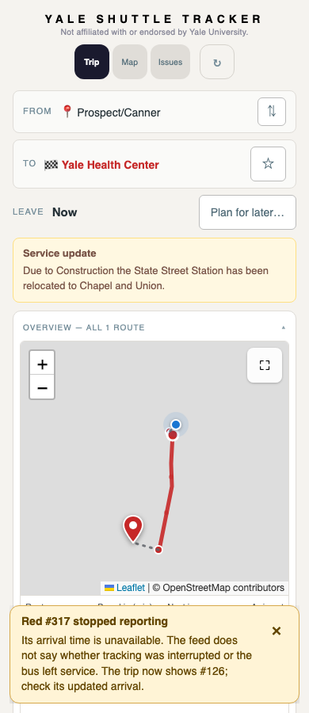
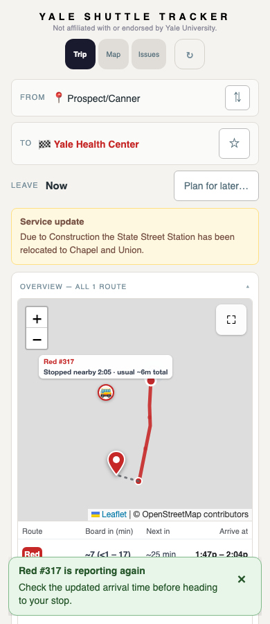

# Bus reporting alerts

When a bus shown in a live trip, the visible map routes, or the active ride
stops reporting, a dismissible notice names the vehicle and explains that its
arrival is unavailable. Trip notices identify the replacement vehicle now shown.
A return produces a separate notice, including when Yale changes the tracking ID.

The monitor requires two successful position polls at least five seconds apart.
A retained observation becomes unavailable at the existing 45-second freshness
limit. Brief gaps, failed app requests, hidden-tab time, timetable filtering,
and ordinary changes of selected arrival do not establish a vehicle outage.
The notices describe reporting, since the feed cannot distinguish tracking loss
from a vehicle leaving service. No notification permission is requested.

Validation: 3,766 tests, backend/frontend type checks, and a production frontend
build passed. `scripts/bus-reporting-check.mjs` drives the actual SPA using the
recorded October 14 Red #317 snapshot and simulated later feed states. It checks
trip, map, and ride at 307px compact Android, 390px, and 1280px, including loss,
dismissal, recovery under a new tracking ID, touch targets, and reflow. All API
requests are intercepted; this is a behavior regression, not an ETA accuracy
measurement. The deployment pipeline runs the same browser regression.

