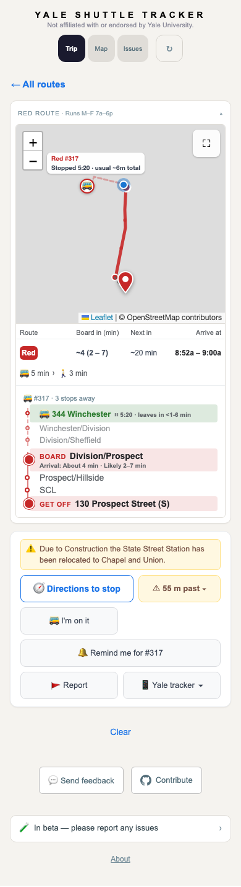

# Report 142: Red waiting at Winchester

The recorded October 15 snapshot had #317 stationary within 75 m of stop 11
(344 Winchester), and the server's standing answer confirmed that stop. Its
pickup forecast correctly counted three stops to Division / Prospect, but its
held display lead still named College / Wall (N), making the expanded route
list eleven stops.

For a fresh served track on a line without repeated calls, the displayed
position now uses the confirmed stationary stop. It requires both the server
stand and the observed stop/proximity evidence. Moving buses, distant/stale
stop flags, expired tracks, and folded routes retain their existing behavior.
This changes the display; the served forecast and estimator callers are unchanged.

Validation: a regression reproduced the original eleven-stop list before the
fix. All 3,773 tests pass after it, including folded-route regressions. The
actual SPA replay at 307px compact Android, 390px, and 1280px shows #317 at
Winchester with three approach stops. All APIs are intercepted and the fixture
contains public feed data only. This checks behavior, not ETA accuracy.

